# Architecture

## Overview

The site is a static Next.js export. At build time, every page is rendered to HTML for every
locale. The output (`out/`) is a folder of plain files that Cloudflare Pages serves from its edge
network. Nothing runs on a server at request time.

```mermaid
flowchart LR
  subgraph Source
    D[i18n dictionaries<br/>src/i18n] --> P
    C[Content<br/>src/content] --> P
    R[Routes<br/>src/lib/routes.ts] --> P
    P[Pages<br/>src/app/&#91;locale&#93;]
  end
  P -- next build --> O[out/<br/>static HTML, CSS, JS]
  O -- git push --> CF[Cloudflare Pages<br/>+ _headers, _redirects]
  CF --> U[Visitors]
```

See [ADR 0001](adr/0001-static-export-on-cloudflare-pages.md) for why there is no server.

## Request flow

| Request                   | What serves it                                                                   |
| ------------------------- | -------------------------------------------------------------------------------- |
| `/`                       | `src/app/page.tsx`: a tiny script picks `en`/`es`/`de` from the browser language |
| `/{locale}/…`             | Pre-rendered HTML from `src/app/[locale]/…`                                      |
| `/privacy`, `/support`, … | 301 redirects from `public/_redirects`                                           |
| Unknown locale or path    | `404.html` from `src/app/not-found.tsx`                                          |
| Any response              | Security headers from `public/_headers` (CSP, HSTS, frame denial…)               |

## Layers

### Routing: `src/lib/routes.ts`

The single source of truth for URLs. Pages, navigation, the language switcher, hreflang
alternates and the sitemap all build links from it, so a URL is never defined twice.

- `routes.*(locale)`: pages that exist in every locale.
- `guideSlugs`: guides, which exist only in some locales and have a localized slug each.

### Internationalisation: `src/i18n/`

- `config.ts` lists the locales (`en` is the default).
- `types.ts` defines the `Dictionary` type, and each `dictionaries/{locale}.ts` must satisfy it.
  A missing key is a **type error**.
- `dictionaries.test.ts` also checks that list lengths match (for example, the same number of
  FAQs) and that no string is empty.
- `getDictionary(locale)` is synchronous: the dictionaries are small and only read at build time.

The locale is the first URL segment (`/es/…`) rather than a cookie or header, because a static
site cannot vary its response per request ([ADR 0002](adr/0002-locale-in-url-path.md)).

### Content: `src/content/`

Content that is too long for a dictionary:

- **Legal** (`legal/*.json`): an intro plus sections of paragraphs. The test checks that every
  locale has the same structure.
- **Guides** (`guides/*.ts`): typed blocks (`p`, `h2`, `ul`, `callout`, `table`) rendered by
  site components instead of raw HTML ([ADR 0003](adr/0003-typed-content-instead-of-markdown.md)).

Inline emphasis uses `**bold**`, parsed by `src/lib/inline-markup.ts` and rendered by
`<RichText>`. No HTML is ever injected from content.

### SEO: `src/lib/seo.ts`, `src/app/sitemap.ts`, `src/app/robots.ts`

`pageMetadata()` builds the title, description, canonical URL, `hreflang` alternates (including
`x-default` → English) and OpenGraph tags. The sitemap lists every page in every locale with its
alternates. Absolute URLs use `NEXT_PUBLIC_SITE_URL`, which is inlined at build time.

### UI: `src/components/`

| Folder      | Contents                                                    |
| ----------- | ----------------------------------------------------------- |
| `brand/`    | Logo and mascot SVG components                              |
| `layout/`   | Page shell, header, footer, language switcher, theme toggle |
| `mitimiti/` | Landing-page specific pieces (phone mockups)                |
| `legal/`    | Shared template for privacy and terms                       |
| `ui/`       | Small reusable pieces (`RichText`, `GuideCard`)             |

Everything is a React Server Component except `theme-toggle.tsx`.

### Theming

Design tokens are CSS variables in `src/app/globals.css`, with a light set on `:root` and a dark
set on `:root[data-theme='dark']`, exposed to Tailwind v4. An inline script in `<head>`
(`src/lib/theme.ts`) sets `data-theme` before first paint, from `localStorage` or the OS
preference, so the page never flashes the wrong theme.

## Quality gates

| Gate                         | Local                        | CI  |
| ---------------------------- | ---------------------------- | --- |
| Prettier                     | pre-commit (lint-staged)     | ✅  |
| ESLint, zero warnings        | pre-commit (lint-staged)     | ✅  |
| TypeScript strict            | `npm run typecheck`          | ✅  |
| Unit tests (Vitest)          | `npm test`                   | ✅  |
| Static export builds         | `npm run build`              | ✅  |
| Conventional Commit messages | commit-msg hook (commitlint) | ✅  |

Dependabot opens weekly dependency update PRs (`.github/dependabot.yml`).
